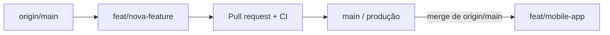

# Desenvolvimento do app e entregas em produção

A `main` contém o código aprovado para produção. O desenvolvimento do aplicativo fica na `feat/mobile-app`. Toda nova feature que precisa chegar antes do app nasce de `origin/main`, em uma pasta de trabalho própria.

| Branch | Uso | Destino |
| --- | --- | --- |
| `main` | Versão aprovada para produção | Frontend e backend no EasyPanel |
| `feat/mobile-app` | Aplicativo em desenvolvimento | Testes locais e homologação |
| `feat/nome` | Uma nova feature de produção | Pull request para `main` |
| `fix/nome` | Uma correção de produção | Pull request para `main` |
| `chore/nome` | Infraestrutura e manutenção | Pull request para `main` |



Não é preciso criar uma `develop`: as branches curtas de feature atendem às entregas web/API, enquanto a branch do app concentra o trabalho que ainda não será publicado.

## Estado preparado neste checkout

- A pasta principal `best-part-school/` está na `feat/mobile-app`. O trabalho que estava sem commit foi preservado em um commit de desenvolvimento.
- `best-part-school/.worktrees/production/` está na `chore/release-workflow`, criada de `origin/main`, com os arquivos deste fluxo e sem o código mobile.
- A `main` local e a remota não receberam o desenvolvimento do app.
- Branches e commits foram preparados localmente. Push, merge, configuração do GitHub e configuração do EasyPanel são etapas separadas.

Worktrees são pastas com arquivos e branch próprios que compartilham o histórico Git. Você pode manter o app aberto no Xcode e desenvolver outra entrega em paralelo. Use `git worktree list` para consultar as pastas e suas branches.

## Ativar o fluxo no GitHub e no EasyPanel

1. No EasyPanel, confirme que **frontend e backend** acompanham apenas a branch `main`, inclusive nos gatilhos de deploy automático. Detalhes em [DEPLOY_EASYPANEL.md](../DEPLOY_EASYPANEL.md).
2. Na pasta principal, publique a branch de infraestrutura:

   ```bash
   git -C .worktrees/production push -u origin chore/release-workflow
   ```

3. Abra um pull request de `chore/release-workflow` para `main`. O diff deve conter somente este fluxo: documentação, comando de feature, template de PR, CI e exclusão de worktrees do Git, Docker e lint.
4. Aguarde os checks `Frontend` e `Backend`, revise e faça o merge.
5. Nas regras da `main` no GitHub, exija pull request, checks `Frontend` e `Backend` aprovados, branch atualizada e conversas resolvidas. Desabilite force push e exclusão da `main`. Se houver outra pessoa revisora, exija uma aprovação; para trabalho individual, não exija uma aprovação que você não pode dar ao próprio PR.
6. Para manter uma cópia remota do app, publique sua branch separadamente:

   ```bash
   git push -u origin feat/mobile-app
   ```

O CI valida PRs destinados à `main` ou à `feat/mobile-app` e pushes nessas duas branches. Ele executa testes/build do frontend e checks, consistência das migrações e testes Django com PostgreSQL temporário. Usa credenciais fictícias de teste e não executa deploy. As regras do GitHub são necessárias para tornar os checks obrigatórios; adicionar o YAML sozinho não impede merges diretos.

Referência: [proteção de branches no GitHub](https://docs.github.com/en/repositories/configuring-branches-and-merges-in-your-repository/managing-protected-branches/about-protected-branches).

## Criar uma feature que vai entrar antes do app

Na pasta principal, execute:

```bash
bash scripts/new-feature.sh feat/relatorio-financeiro
cd .worktrees/feat/relatorio-financeiro
npm ci
npm run dev -- --port 8083
```

O comando busca o estado atual do GitHub e cria a branch exclusivamente de `origin/main`. Se a busca falhar, a branch/pasta já existir ou o nome for inválido, ele para sem sobrescrever trabalho. Não troca a branch nem altera os arquivos do app. Também pode ser executado de outro worktree que contenha o script.

Para correções, use `fix/nome-da-correcao`. Nomes aceitam letras minúsculas, números e hífens.

Instale dependências em cada worktree. Configurações `.env`, banco local e processos de desenvolvimento pertencem à pasta correspondente. Para trabalhar no backend, prepare um ambiente virtual e banco de desenvolvimento próprios seguindo o [README](../README.md). Use portas diferentes dos processos do app e um nome de projeto Compose distinto se executar Docker em paralelo.

### Implementar, validar e enviar

Dentro da pasta da feature:

```bash
# Implemente a entrega e valide o frontend, quando alterado.
npm test
npm run build

# Revise tudo que entrará no PR, incluindo arquivos ainda não adicionados.
git status --short
git diff
git diff origin/main...HEAD

# Adicione explicitamente os arquivos da entrega.
git add caminho/do/arquivo outro/arquivo
git diff --cached
git commit -m "feat: adiciona relatorio financeiro"
git push -u origin feat/relatorio-financeiro
```

Abra o PR com base **`main`**. Para backend, execute também `python manage.py check`, `python manage.py makemigrations --check --dry-run` e os testes pertinentes, com o ambiente e banco de desenvolvimento configurados. O CI executa a suíte das aplicações Django.

Se a `main` avançou durante o desenvolvimento, salve suas alterações em commits e atualize a feature antes do merge:

```bash
git fetch origin
git merge origin/main
# Resolva eventuais conflitos e execute novamente as validações afetadas.
git push
```

Depois dos checks e revisão, faça **squash merge** das features curtas. Isso gera um commit por entrega na `main`. O EasyPanel publica esse código se o deploy automático estiver habilitado. Confirme login e o fluxo alterado no ambiente publicado.

## Continuar o app recebendo as melhorias de produção

Na pasta principal, com o trabalho local salvo em commits:

```bash
git branch --show-current
# Deve mostrar feat/mobile-app.
git fetch origin
git merge origin/main
npm ci
npm test
npm run build
# Teste também os destinos mobile afetados.
```

A direção habitual é **`main` → `feat/mobile-app`**. Só abra o PR do app para `main` quando a entrega completa estiver pronta e for intencional publicá-la. Não faça merge da branch do app em uma feature que precisa sair antes dele.

Se uma melhoria já implementada no app precisar entrar antes, reimplemente a mudança isolada em uma branch criada de `origin/main`. Use `cherry-pick` apenas se o commit for independente e não depender da estrutura mobile. O commit inicial de desenvolvimento reúne o trabalho do app e não deve ser copiado inteiro para uma feature de produção.

Como o backend é compartilhado, alterações de API publicadas precisam manter compatibilidade com os clientes em uso. Planeje migrações e alterações incompatíveis antes de liberar o app nas lojas.

## Encerrar uma entrega

Após o merge, na pasta principal:

```bash
git fetch origin
git worktree list
git worktree remove .worktrees/feat/relatorio-financeiro
```

O Git recusa remover um worktree com alterações pendentes. Não use `--force` para contornar isso. A branch local pode ser mantida para consulta; após squash merge, `git branch -d` pode recusar a exclusão por não reconhecer os commits originais como integrados.

## Reverter uma entrega em produção

Crie `fix/reverte-nome` com o mesmo comando de nova feature. Dentro dessa pasta, use `git revert <sha-do-commit-na-main>`, revise o resultado e envie um PR para `main`. O rollback de código não desfaz migrações ou dados: avalie esses efeitos antes do deploy.
